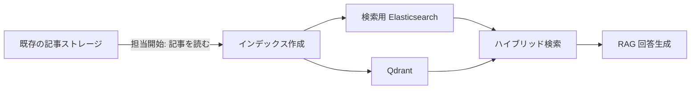

# News Search & RAG

[한국어](README.md) | **日本語**

ニュース記事を検索に活用するため、**検索用インデックスの構築、キーワード・ベクトル検索、RAG による回答生成**に取り組んだプロジェクトです。繰り返し処理の負担を減らし、新着記事をより早く検索に反映するため、インデックス処理を改善しました。
<!-- CLM-005: USER,CODE,RUNTIME,RETROSPECTIVE / CONFIRMED; CLM-014: USER,CODE,RUNTIME,RETROSPECTIVE / CONFIRMED; CLM-021: USER,RETROSPECTIVE / CONFIRMED; CLM-043: USER / CONFIRMED -->

**利用場面の例:** 「昨日の半導体関連ニュースを教えて」→ 日付範囲を解釈 → 関連記事を検索 → 検索結果をもとに回答を生成。当時の機能を説明する架空の質問であり、現在の公開コードの実行結果ではありません。
<!-- CLM-064: USER,CODE,PROPOSAL,RETROSPECTIVE / CONFIRMED; CLM-065: USER,CODE,RETROSPECTIVE / CONFIRMED; CLM-067: USER,RETROSPECTIVE / CONFIRMED; CLM-021: USER,RETROSPECTIVE / CONFIRMED; REC-007: RECONSTRUCTED -->

| | プロジェクト概要 |
|---|---|
| 期間 | 2025.08–2026.02 |
| 担当範囲 | 既存の記事ストレージ以降の検索用 Elasticsearch へのリインデックス、Qdrant への格納、RAG パイプライン |
| 検索 | Elasticsearch BM25 + Qdrant dense retrieval。最終的な結果の統合に RRF を使用 |
| 規模 | Elasticsearch への取り込み中に累計約1万件の記事を確認 |
<!-- CLM-046: USER / CONFIRMED; CLM-041: USER / CONFIRMED; CLM-014: USER,CODE,RUNTIME,RETROSPECTIVE / CONFIRMED; CLM-015: USER,RETROSPECTIVE,CODE,PROPOSAL / CONFIRMED; CLM-038: USER,RETROSPECTIVE / CONFIRMED -->

> **このリポジトリの範囲**
>
> 当時の経験と開発記録をもとに、AI ツールを活用して**インデックス作成コアとストレージアダプターを現在あらためて実装**しました。当時の運用コードそのものの公開や、サービス全体の再現を主張するものではありません。検索・RAG・Graph Search は当時の経験であり、現在の公開コードにはまだ含まれていません。
<!-- REC-001, REC-007: RECONSTRUCTED; CLM-014: USER,CODE,RUNTIME,RETROSPECTIVE / CONFIRMED; CLM-021: USER,RETROSPECTIVE / CONFIRMED; CLM-031: USER,CODE,RETROSPECTIVE / CONFIRMED -->

[プロジェクト構成](#プロジェクト構成) · [課題と対応](#課題と対応) · [現在の公開コード](#現在の公開コード) · [テストと実行](#テストと実行)

## プロジェクト構成

### 当時の機能関係



担当は既存の記事ストレージを**読み込む段階から**です。そのストレージへのデータ取り込みは別のメンバーが担当しました。この図は確認された機能関係を示すもので、実際の配置構成や ES 全件処理の完了後に Qdrant 処理が始まるという実行順序を確定するものではありません。
<!-- CLM-005: USER,CODE,RUNTIME,RETROSPECTIVE / CONFIRMED; CLM-041: USER / CONFIRMED; CLM-014: USER,CODE,RUNTIME,RETROSPECTIVE / CONFIRMED; CLM-015: USER,RETROSPECTIVE,CODE,PROPOSAL / CONFIRMED; CLM-021: USER,RETROSPECTIVE / CONFIRMED; CLM-052: USER,CODE,PROPOSAL,RETROSPECTIVE / UNRESOLVED -->

### インデックス処理の変化

| | v1 | v2 |
|---|---|---|
| 記事の処理 | 定期バッチ | 定期的に確認し、**新着記事のみ**を差分処理 |
| Qdrant への保存 | 単一の dense vector | タイトル用・本文用の2つの named vectors |

v2 では、繰り返しの取得・処理負担を減らし、新着ニュースを検索へ早く反映することを目指しました。既存記事の更新・削除の同期は対象外です。これは**改善目的**であり、処理時間の定量比較は確認されていません。
<!-- CLM-001: USER,CODE,PROPOSAL / CONFIRMED; CLM-002: USER / CONFIRMED; CLM-003: USER,CODE,RUNTIME,RETROSPECTIVE / CONFIRMED; CLM-004: USER,CODE,RETROSPECTIVE / CONFIRMED; CLM-043: USER / CONFIRMED -->

| 範囲 | 当時のプロジェクト | 現在の公開コード |
|---|---|---|
| インデックス作成 | 記事のリインデックスとチャンクベクトルの格納 | **変換コアと ES・Qdrant アダプター** |
| 検索 | BM25・dense 検索の結合と RRF | 未実装 |
| RAG | 検索結果をコンテキストとした回答生成 | 未実装 |
| Graph Search | Neo4j の検索結果を回答コンテキストに利用 | 未実装 |
<!-- CLM-005: USER,CODE,RUNTIME,RETROSPECTIVE / CONFIRMED; CLM-014: USER,CODE,RUNTIME,RETROSPECTIVE / CONFIRMED; CLM-015: USER,RETROSPECTIVE,CODE,PROPOSAL / CONFIRMED; CLM-021: USER,RETROSPECTIVE / CONFIRMED; CLM-031: USER,CODE,RETROSPECTIVE / CONFIRMED; REC-001, REC-007: RECONSTRUCTED -->

## 課題と対応

### キーワード検索と意味検索の結合

**アプローチ:** Elasticsearch の BM25 検索と Qdrant の dense 検索を両方実行して結果を結合し、最終的な統合に RRF を使用しました。

**確認された範囲:** 両方の検索結果の結合と最終的な RRF 使用は確認済みです。細かな結合順序と重みは未確定です。
<!-- CLM-014: USER,CODE,RUNTIME,RETROSPECTIVE / CONFIRMED; CLM-015: USER,RETROSPECTIVE,CODE,PROPOSAL / CONFIRMED; CLM-017: USER,CODE,PROPOSAL / PROBABLE; CLM-018: CODE,PROPOSAL,RETROSPECTIVE / UNRESOLVED -->

### Neo4j deadlock

| 段階 | 当時の経験 |
|---|---|
| 問題 | 記事ごとの並列 `MERGE` 中に `DeadlockDetected` が発生 |
| 対応 | `UNWIND` による batch upsert と retry/backoff を適用 |
| 結果 | 変更を反映して再実行し、該当障害を解決 |
| 限界 | 恒久的な再発防止と定量的な性能効果は未確認 |
<!-- CLM-028: USER,CODE,RUNTIME,RETROSPECTIVE / CONFIRMED; CLM-029: USER,CODE,RUNTIME,RETROSPECTIVE / CONFIRMED -->

これは当時の障害対応経験であり、現在の公開コードに Neo4j の実装があることを意味しません。[対応の詳細](docs/neo4j-deadlock.ja.md)
<!-- CLM-028, CLM-029: USER,CODE,RUNTIME,RETROSPECTIVE / CONFIRMED; REC-007: RECONSTRUCTED -->

### データ規模と応答時間

- **記事の累計約1万件:** Elasticsearch への取り込み中に確認した規模です。日次処理量や Qdrant point 数ではありません。
- **30秒以上 → 10〜15秒:** 当時報告した RAG 応答時間の観測値です。測定条件や個別の改善施策の寄与は未確定です。
<!-- CLM-038: USER,RETROSPECTIVE / CONFIRMED; CLM-023: USER,RUNTIME,RETROSPECTIVE / CONFIRMED; CLM-044: USER,CODE,PROPOSAL,RETROSPECTIVE / UNRESOLVED -->

## 現在の公開コード

記事本文をチャンクに分け、ベクトル point に変換します。埋め込みと point ID はインターフェースとして分離し、アダプターを通して記事と point を保存します。**テスト用ベクトルは意味検索モデルではありません。**
<!-- REC-001, REC-007: RECONSTRUCTED -->

| 確認できる内容 | 実装とテスト |
|---|---|
| 記事 → チャンク → point の変換 | [pipeline.py](src/news_rag_reconstruction/pipeline.py) · [chunking.py](src/news_rag_reconstruction/chunking.py) |
| ES・Qdrant の保存境界 | [storage.py](src/news_rag_reconstruction/storage.py) · [adapters](src/news_rag_reconstruction/adapters/) |
| バッチ保存と部分失敗 | [batch.py](src/news_rag_reconstruction/batch.py) · [部分失敗テスト](tests/test_batch.py#L133) |

各バッチは変換後、ES、Qdrant の順に保存します。Qdrant の保存に失敗した場合、完了済みの ES 保存は rollback されません。現在のコードは rollback・retry・checkpoint を提供しません。これは現在の再構成における保存順序と失敗境界です。
<!-- REC-007: RECONSTRUCTED -->

### 実行せずに見る変換例

架空の記事を分割した**実際の実行結果**です。各チャンクは同じ記事 ID を持ち、3次元のテスト用ベクトルとともに point を構成します。

```text
入力記事: news-001 | 図書館の夜間利用を延長
本文: 市立図書館が夜間の開館時間を二時間延長した。

chunk[0] article_id=news-001 text="市立図書館が夜間の開館時間を" vector_dim=3
chunk[1] article_id=news-001 text="館時間を二時間延長した。" vector_dim=3
```

チャンクサイズ14・オーバーラップ4・ベクトル次元3は例示用で、この例では検索や外部 DB への保存を実行しません。[変換例と実行方法](docs/usage.md#example) · [当時の構成と現在のコード](docs/architecture.ja.md)

## テストと実行

Python 3.11 以上と [uv](https://docs.astral.sh/uv/) が必要です。

```bash
uv sync --locked --dev
uv run --no-sync pytest
```

初回の依存関係インストールにはネットワーク接続が必要な場合があります。テストには架空の記事、stub、Qdrant のメモリストレージを使うため、API キーや外部サーバーは不要です。2026-11-02 のローカル検証で**テスト75件**、Ruff、mypy が通過しました。実ストレージ統合や検索品質・運用性能の検証を意味するものではありません。
<!-- REC-001, REC-007: RECONSTRUCTED -->

<details>
<summary>静的解析と実行例</summary>

```bash
uv run --no-sync ruff check src tests
uv run --no-sync ruff format --check src tests
uv run --no-sync mypy src tests
```

架空の記事を使った変換例は[実行ガイド](docs/usage.md#example)を参照してください。

</details>
