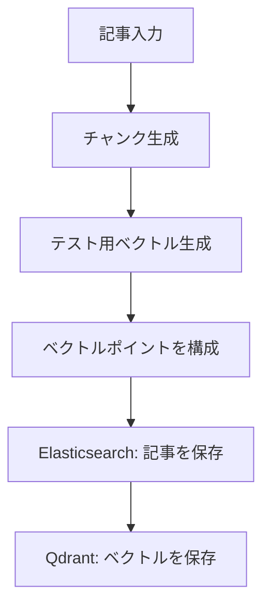

# News Indexing Pipeline

[한국어](README.md) | **日本語**

ニュース記事を検索用文書とベクトルポイントに変換する**インデックス作成パイプラインの再構成プロジェクト**です。ストレージから独立した変換コアと Elasticsearch・Qdrant のアダプターを実装し、架空のデータを使ってローカルで検証できます。

> **現在の状態 · RECONSTRUCTED**
>
> このコードは、以前のニュース検索プロジェクトでの経験と関連する開発記録を参考に、現在あらためて作成した実装です。当時の運用コードや設定をそのまま再現したとは主張しません。（REC-001、REC-007）

## 概要

| 項目 | 内容 |
|---|---|
| 処理の流れ | 記事の取得 → チャンク化 → ベクトル生成 → 記事・ベクトルの保存 |
| 実装 | Python、Elasticsearch アダプター、Qdrant アダプター |
| 検証 | 架空の記事、stub、Qdrant のメモリストレージを利用したテスト |
| 現在の範囲 | インデックス作成コアと保存境界。検索・RAG サービス全体は未実装 |
| 主な制約 | fixture ベクトルは意味検索用モデルではなく、2つのストレージ間の rollback は未対応 |

## アーキテクチャ



図は**現在のバッチ内の処理**です。変換コアは外部サービスにアクセスせず、アダプターを介してストレージに接続します。バッチごとに変換し、ES、Qdrant の順に保存します。

| ファイル | 役割 |
|---|---|
| [models.py](src/news_rag_reconstruction/models.py) | 記事・チャンク・ベクトル・payload の不変データモデル |
| [chunking.py](src/news_rag_reconstruction/chunking.py) | 指定されたサイズとオーバーラップで本文を分割 |
| [embeddings.py](src/news_rag_reconstruction/embeddings.py) | provider の契約と決定的なテストベクトル |
| [point_ids.py](src/news_rag_reconstruction/point_ids.py) | point ID の契約と UUID5 の実装 |
| [pipeline.py](src/news_rag_reconstruction/pipeline.py) | 記事を単一ベクトル point に変換 |
| [batch.py](src/news_rag_reconstruction/batch.py) · [adapters](src/news_rag_reconstruction/adapters/) | バッチ処理と ES・Qdrant の保存境界 |

## セットアップと検証

Python 3.11 以上と [uv](https://docs.astral.sh/uv/) が必要です。

```bash
uv sync --locked --dev
uv run --no-sync pytest
uv run --no-sync ruff check src tests
uv run --no-sync ruff format --check src tests
uv run --no-sync mypy src tests
```

初回の依存関係インストールにはネットワーク接続が必要な場合があります。テストには架空の記事とテスト用ストレージを使用するため、API キーや外部の Elasticsearch・Qdrant サーバーは不要です。

架空の記事を変換する実行例は[韓国語 README](README.md#가상-기사-변환해-보기)に掲載しています。例のサイズ・次元・namespace は動作確認用であり、過去の運用設定を示すものではありません。

## 設計と検証範囲

- 埋め込みと ID 生成をインターフェースとして分離し、外部ストレージなしで変換ロジックを検証します。
- 本文が空の場合は point を作成しません。入力の検証、チャンク境界、provider の結果数、変換結果の決定性をテストします。
- 保存エラーは呼び出し元に伝播します。ES 保存後に Qdrant が失敗した場合、ES に保存済みのデータは rollback しません。
- テストは現在のコードの契約を検証します。実ストレージとの統合、検索品質・処理量・運用性能は未検証です。
- 実際の埋め込み API、Airflow、差分処理、検索 API、RAG 回答生成、UI はまだ提供していません。

## プロジェクトの背景と現在の実装

### 以前のプロジェクトでの経験

既存の記事ストレージから検索用・ベクトル用ストレージにデータを構成するパイプラインと、RAG 機能を実装しました。以下は当時の確認された経験であり、現在のリポジトリですべて実行できることを意味しません。（USER / CONFIRMED: CLM-005、CLM-041）

| 課題とアプローチ | 当時確認された経験 |
|---|---|
| 記事検索 | Elasticsearch の BM25 と Qdrant の dense 検索を組み合わせ、最終的な結果の統合に RRF を使用しました。（CLM-014、CLM-015） |
| 自然言語の日付 | 時間表現を日付範囲に変換して検索に適用し、特定日・相対日付の質問で結果が返ることを確認しました。（CLM-064、CLM-065、CLM-066） |
| グラフ保存時のエラー | Neo4j の並列 `MERGE` で deadlock を経験し、batch upsert と retry/backoff を適用・再実行して解決しました。（CLM-028、CLM-029） |

### このリポジトリでの実装

上記の経験と開発記録を参考に、記事の変換、テスト用埋め込み、ストレージアダプターとテストを現在あらためて作成しました。実行可能な範囲と制約は[設計と検証範囲](#設計と検証範囲)を参照してください。当時の運用コード・設定や検索品質を完全に再現したことを意味しません。（RECONSTRUCTED: REC-001、REC-007）

実際の記事・運用アドレス・認証情報は含めず、テストでは架空の記事を使用します。
