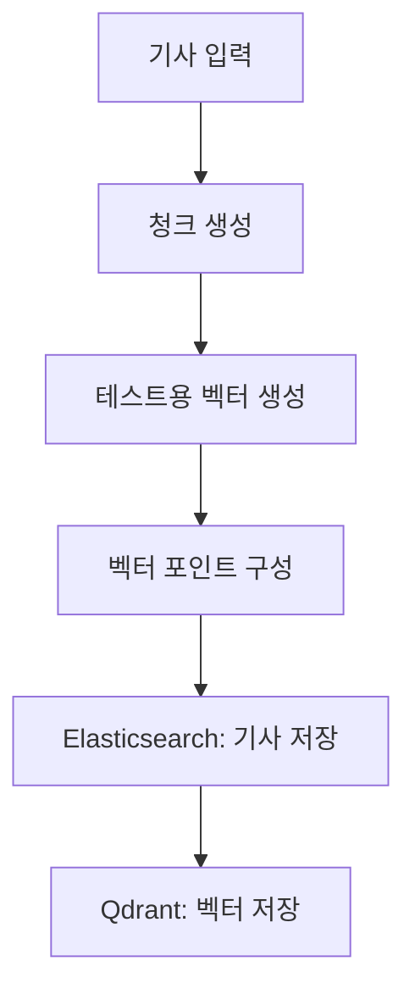

# News Indexing Pipeline

**한국어** | [日本語](README.ja.md)

뉴스 기사를 검색용 문서와 벡터 포인트로 변환하는 **인덱싱 파이프라인 복원 프로젝트**입니다. 외부 저장소를 추상화한 변환 코어와 Elasticsearch·Qdrant 어댑터를 제공하며, 가상 데이터로 로컬에서 검증할 수 있습니다.

> **현재 상태 · RECONSTRUCTED**
>
> 이 코드는 이전 뉴스 검색 프로젝트 경험과 관련 개발 기록을 참고해 현재 다시 작성한 구현입니다. 당시 운영 코드나 설정을 그대로 재현했다고 주장하지 않습니다. (REC-001, REC-007)

## 한눈에 보기

| 항목 | 내용 |
|---|---|
| 처리 흐름 | 기사 읽기 → 청크 생성 → 벡터 생성 → 기사·벡터 저장 |
| 구현 | Python, Elasticsearch 어댑터, Qdrant 어댑터 |
| 검증 | 가상 기사, stub, Qdrant 메모리 저장소를 사용하는 테스트 |
| 현재 범위 | 인덱싱 코어와 저장 경계. 전체 검색·RAG 서비스는 미구현 |
| 핵심 한계 | fixture 벡터는 의미 검색용 모델이 아님. 두 저장소 간 rollback 없음 |

## 구조



위 그림은 **현재 코드의 배치 내 처리 흐름**입니다. 순수 변환 코어는 외부 서비스에 접근하지 않으며, 어댑터를 통해 저장소에 연결합니다. 배치 단위로 변환한 뒤 ES, Qdrant 순으로 저장합니다.

| 구성 | 역할 |
|---|---|
| [models.py](src/news_rag_reconstruction/models.py) | 기사, 청크, 벡터, payload의 불변 데이터 모델 |
| [chunking.py](src/news_rag_reconstruction/chunking.py) | 명시적으로 지정한 크기와 겹침으로 본문을 분할 |
| [embeddings.py](src/news_rag_reconstruction/embeddings.py) | 임베딩 provider 계약과 결정적 테스트 벡터 |
| [point_ids.py](src/news_rag_reconstruction/point_ids.py) | point ID 전략 계약과 UUID5 구현 |
| [pipeline.py](src/news_rag_reconstruction/pipeline.py) | 한 기사를 단일 벡터 point로 변환 |
| [batch.py](src/news_rag_reconstruction/batch.py) · [adapters](src/news_rag_reconstruction/adapters/) | 배치 조정과 ES·Qdrant 저장 경계 |

## 실행과 검증

Python 3.11 이상과 [uv](https://docs.astral.sh/uv/)가 필요합니다.

```bash
uv sync --locked --dev
uv run --no-sync pytest
uv run --no-sync ruff check src tests
uv run --no-sync ruff format --check src tests
uv run --no-sync mypy src tests
```

초기 의존성 설치에는 네트워크가 필요할 수 있습니다. 검사는 가상 기사와 테스트 저장소를 사용하므로 API 키나 외부 Elasticsearch·Qdrant 서버는 필요하지 않습니다.

### 가상 기사 변환해 보기

```bash
uv run --no-sync python - <<'PY'
from uuid import NAMESPACE_URL

from news_rag_reconstruction.chunking import CharacterChunker
from news_rag_reconstruction.embeddings import FixtureEmbeddingProvider
from news_rag_reconstruction.models import Article
from news_rag_reconstruction.pipeline import V1IndexingPipeline
from news_rag_reconstruction.point_ids import UUID5PointIdStrategy

article = Article(
    article_id="example-1",
    title="가상 기사",
    content="도서관의 야간 열람 시간이 연장됩니다.",
    organization=None,
    published_at=None,
)
pipeline = V1IndexingPipeline(
    chunker=CharacterChunker(chunk_size=12, chunk_overlap=2),
    embedding_provider=FixtureEmbeddingProvider(dimension=3),
    point_id_strategy=UUID5PointIdStrategy(namespace=NAMESPACE_URL),
)
for point in pipeline.build_points(article):
    print(point.payload.chunk_index, point.payload.text, point.point_id)
PY
```

예시의 크기·차원·namespace는 동작 확인용이며 과거 운영 설정을 의미하지 않습니다.

## 설계와 검증 범위

- 임베딩과 ID 생성을 인터페이스로 분리해 저장소 없이 변환 로직을 검증합니다.
- 빈 본문은 벡터 포인트를 만들지 않습니다. 입력 유효성, 청크 경계, provider 결과 수와 변환 결과의 결정성을 테스트합니다.
- 저장 실패는 호출자에게 전달됩니다. ES 저장 후 Qdrant에서 실패하면 이미 저장된 ES 데이터는 되돌리지 않습니다.
- 테스트 결과는 현재 코드의 계약을 보여줍니다. 실제 저장소 통합, 검색 품질·처리량·운영 성능은 검증하지 않았습니다.
- 실제 임베딩 API, Airflow, 증분 처리, 검색 API, RAG 답변 생성과 UI는 아직 제공하지 않습니다.

## 프로젝트 배경과 현재 구현

### 이전 프로젝트 경험

기존 기사 저장소부터 검색용 저장소와 벡터 저장소를 구성하는 파이프라인 및 RAG 기능을 구현했습니다. 다음은 당시 확인된 경험으로, 현재 저장소에서 모두 실행할 수 있다는 뜻은 아닙니다. (USER / CONFIRMED: CLM-005, CLM-041)

| 문제와 접근 | 당시 확인된 경험 |
|---|---|
| 기사 검색 | Elasticsearch의 BM25 검색과 Qdrant의 dense 검색을 결합하고 최종 fusion으로 RRF를 사용했습니다. (CLM-014, CLM-015) |
| 자연어 날짜 | 자연어 시간 표현을 날짜 범위로 해석해 검색에 적용하고 특정 날짜와 상대 날짜 질의에서 결과 반환을 확인했습니다. (CLM-064, CLM-065, CLM-066) |
| 그래프 저장 오류 | Neo4j 병렬 `MERGE`에서 deadlock을 경험한 뒤 batch upsert와 retry/backoff를 적용·재실행해 해결했습니다. (CLM-028, CLM-029) |

### 이 저장소에서 구현한 것

위 경험과 개발 기록을 참고해 기사 변환, 가상 임베딩, 저장소 어댑터와 테스트를 현재 다시 작성했습니다. 실행 가능한 범위와 한계는 위 [설계와 검증 범위](#설계와-검증-범위)에 정리했습니다. 과거 운영 코드·설정의 완전한 재현이나 검색 품질의 재현을 의미하지 않습니다. (RECONSTRUCTED: REC-001, REC-007)

실제 기사·운영 주소·인증정보는 포함하지 않으며 테스트에는 가상 기사만 사용합니다.
