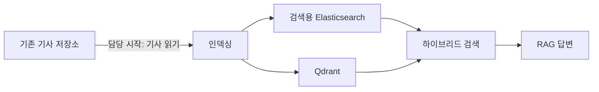

# News Search & RAG

**한국어** | [日本語](README.ja.md)

뉴스 기사를 검색에 활용하기 위해 **검색용 인덱싱, 키워드·벡터 검색, RAG 답변 흐름**을 구축한 프로젝트입니다. 반복 처리의 부담을 줄이고 신규 기사가 검색에 더 빠르게 반영되도록 인덱싱 방식을 개선했습니다.
<!-- CLM-005: USER,CODE,RUNTIME,RETROSPECTIVE / CONFIRMED; CLM-014: USER,CODE,RUNTIME,RETROSPECTIVE / CONFIRMED; CLM-021: USER,RETROSPECTIVE / CONFIRMED; CLM-043: USER / CONFIRMED -->

**사용 장면 예시:** “어제의 반도체 관련 뉴스를 알려줘” → 날짜 범위 해석 → 관련 기사 검색 → 검색 결과를 바탕으로 답변 생성. 당시 기능을 설명하는 가상 질의이며 현재 공개 코드의 실행 결과는 아닙니다.
<!-- CLM-064: USER,CODE,PROPOSAL,RETROSPECTIVE / CONFIRMED; CLM-065: USER,CODE,RETROSPECTIVE / CONFIRMED; CLM-067: USER,RETROSPECTIVE / CONFIRMED; CLM-021: USER,RETROSPECTIVE / CONFIRMED; REC-007: RECONSTRUCTED -->

| | 프로젝트 요약 |
|---|---|
| 기간 | 2025.08–2026.02 |
| 담당 | 기존 기사 저장소 이후의 검색용 Elasticsearch 리인덱싱, Qdrant 적재, RAG 파이프라인 |
| 검색 | Elasticsearch BM25 + Qdrant dense retrieval, 최종 결과 결합에 RRF 사용 |
| 규모 | Elasticsearch 적재 과정에서 누적 약 1만 건의 기사 확인 |
<!-- CLM-046: USER / CONFIRMED; CLM-041: USER / CONFIRMED; CLM-014: USER,CODE,RUNTIME,RETROSPECTIVE / CONFIRMED; CLM-015: USER,RETROSPECTIVE,CODE,PROPOSAL / CONFIRMED; CLM-038: USER,RETROSPECTIVE / CONFIRMED -->

> **이 저장소의 범위**
>
> 당시 경험과 개발 기록을 바탕으로 AI 도구를 활용해 **인덱싱 코어와 저장소 어댑터를 현재 다시 구현**했습니다. 과거 운영 코드를 그대로 공개하거나 전체 서비스가 현재 동작한다고 주장하지 않습니다. 검색·RAG·Graph Search는 당시의 경험이며, 공개 코드에는 아직 포함되지 않았습니다.
<!-- REC-001, REC-007: RECONSTRUCTED; CLM-014: USER,CODE,RUNTIME,RETROSPECTIVE / CONFIRMED; CLM-021: USER,RETROSPECTIVE / CONFIRMED; CLM-031: USER,CODE,RETROSPECTIVE / CONFIRMED -->

[프로젝트 구조](#프로젝트-구조) · [문제 해결](#문제-해결) · [현재 코드](#현재-공개-코드) · [테스트](#테스트와-실행)

## 프로젝트 구조

### 당시 기능 관계



담당 범위는 기존 기사 저장소를 **읽는 단계부터**입니다. 초기 데이터가 해당 저장소에 들어오기까지의 적재는 다른 팀원이 담당했습니다. 이 그림은 확인된 기능 관계를 설명하며 실제 배포 구성이나 모든 ES 처리 완료 후 Qdrant 처리가 시작되는 실행 순서를 확정하지 않습니다.
<!-- CLM-005: USER,CODE,RUNTIME,RETROSPECTIVE / CONFIRMED; CLM-041: USER / CONFIRMED; CLM-014: USER,CODE,RUNTIME,RETROSPECTIVE / CONFIRMED; CLM-015: USER,RETROSPECTIVE,CODE,PROPOSAL / CONFIRMED; CLM-021: USER,RETROSPECTIVE / CONFIRMED; CLM-052: USER,CODE,PROPOSAL,RETROSPECTIVE / UNRESOLVED -->

### 인덱싱 방식의 변화

| | v1 | v2 |
|---|---|---|
| 기사 처리 | 정기 배치 | 주기적으로 확인해 **새로 들어온 기사만** 증분 처리 |
| Qdrant 저장 | 단일 dense vector | 제목·본문을 위한 두 named vectors |

v2는 반복 조회·처리의 부담을 줄이고 신규 뉴스가 검색에 더 빨리 반영되도록 개선한 버전입니다. 기존 기사 수정·삭제의 동기화는 대상이 아니었습니다. 이는 **개선 목적**이며 정량적인 처리 시간 비교는 확인되지 않았습니다.
<!-- CLM-001: USER,CODE,PROPOSAL / CONFIRMED; CLM-002: USER / CONFIRMED; CLM-003: USER,CODE,RUNTIME,RETROSPECTIVE / CONFIRMED; CLM-004: USER,CODE,RETROSPECTIVE / CONFIRMED; CLM-043: USER / CONFIRMED -->

| 범위 | 당시 프로젝트 | 현재 공개 코드 |
|---|---|---|
| 인덱싱 | 기사 리인덱싱 및 청크 벡터 적재 | **변환 코어와 ES·Qdrant 어댑터** |
| 검색 | BM25·dense 검색 결합 및 RRF | 미구현 |
| RAG | 검색 결과를 문맥으로 답변 생성 | 미구현 |
| Graph Search | Neo4j 조회 결과를 답변 문맥에 활용 | 미구현 |
<!-- CLM-005: USER,CODE,RUNTIME,RETROSPECTIVE / CONFIRMED; CLM-014: USER,CODE,RUNTIME,RETROSPECTIVE / CONFIRMED; CLM-015: USER,RETROSPECTIVE,CODE,PROPOSAL / CONFIRMED; CLM-021: USER,RETROSPECTIVE / CONFIRMED; CLM-031: USER,CODE,RETROSPECTIVE / CONFIRMED; REC-001, REC-007: RECONSTRUCTED -->

## 문제 해결

### 키워드 검색과 의미 검색 결합

**접근:** Elasticsearch의 BM25 검색과 Qdrant의 dense 검색을 모두 실행해 결과를 결합했고, 최종 fusion으로 RRF를 사용했습니다.

**확인 범위:** 두 검색의 결합과 최종 RRF 사용은 확인됐습니다. 정확한 결합 단계와 가중치는 확인되지 않아 여기서 확정하지 않습니다.
<!-- CLM-014: USER,CODE,RUNTIME,RETROSPECTIVE / CONFIRMED; CLM-015: USER,RETROSPECTIVE,CODE,PROPOSAL / CONFIRMED; CLM-017: USER,CODE,PROPOSAL / PROBABLE; CLM-018: CODE,PROPOSAL,RETROSPECTIVE / UNRESOLVED -->

### Neo4j deadlock

| 단계 | 당시 경험 |
|---|---|
| 문제 | 기사별 병렬 `MERGE` 중 `DeadlockDetected` 발생 |
| 대응 | `UNWIND` batch upsert와 retry/backoff 적용 |
| 결과 | 변경을 반영하고 재실행해 해당 장애 해결 |
| 한계 | 영구 무재발과 정량적인 성능 효과는 확인되지 않음 |
<!-- CLM-028: USER,CODE,RUNTIME,RETROSPECTIVE / CONFIRMED; CLM-029: USER,CODE,RUNTIME,RETROSPECTIVE / CONFIRMED -->

당시 해결 경험을 설명한 사례이며, 현재 공개 코드에 Neo4j 구현이 포함되어 있다는 뜻은 아닙니다. [문제 해결 상세](docs/neo4j-deadlock.md)
<!-- CLM-028, CLM-029: USER,CODE,RUNTIME,RETROSPECTIVE / CONFIRMED; REC-007: RECONSTRUCTED -->

### 규모와 응답 시간

- **누적 기사 약 1만 건:** Elasticsearch 적재 과정에서 직접 확인한 규모입니다. 일일 처리량이나 Qdrant point 수를 뜻하지 않습니다.
- **30초 이상 → 10~15초:** 당시 직접 보고한 RAG 응답 시간 관측입니다. 반복 benchmark나 특정 개선 하나의 효과로 확정된 수치는 아닙니다.
<!-- CLM-038: USER,RETROSPECTIVE / CONFIRMED; CLM-023: USER,RUNTIME,RETROSPECTIVE / CONFIRMED; CLM-044: USER,CODE,PROPOSAL,RETROSPECTIVE / UNRESOLVED -->

## 현재 공개 코드

현재 구현은 기사 본문을 청크로 나누고 벡터 포인트로 변환합니다. 임베딩과 point ID는 인터페이스로 분리했으며, 어댑터를 통해 기사와 포인트를 저장합니다. **테스트용 벡터는 의미 검색 모델이 아닙니다.**
<!-- REC-001, REC-007: RECONSTRUCTED -->

| 살펴볼 부분 | 구현과 테스트 |
|---|---|
| 기사 → 청크 → point 변환 | [pipeline.py](src/news_rag_reconstruction/pipeline.py) · [chunking.py](src/news_rag_reconstruction/chunking.py) |
| ES·Qdrant 저장 경계 | [storage.py](src/news_rag_reconstruction/storage.py) · [adapters](src/news_rag_reconstruction/adapters/) |
| 배치 저장과 부분 실패 | [batch.py](src/news_rag_reconstruction/batch.py) · [부분 실패 테스트](tests/test_batch.py#L133) |

배치는 변환 뒤 ES, Qdrant 순서로 저장합니다. Qdrant 저장이 실패하면 이미 끝난 ES 저장은 되돌리지 않으며, 현재 코드는 rollback·retry·checkpoint를 제공하지 않습니다. 이 저장 순서와 실패 경계는 현재 재구현의 선택입니다.
<!-- REC-007: RECONSTRUCTED -->

### 실행하지 않고 보는 변환 예시

가상의 기사 한 건을 나눈 **실제 실행 결과**입니다. 각 청크는 같은 기사 ID를 갖고, 길이가 3인 테스트용 벡터와 함께 point로 만들어집니다.

```text
입력 기사: news-001 | 가상 도서관 야간 운영 연장
본문: 도서관이 야간 열람 시간을 두 시간 연장한다.

chunk[0] article_id=news-001 text="도서관이 야간 열람 시간을" vector_dim=3
chunk[1] article_id=news-001 text=" 시간을 두 시간 연장한다" vector_dim=3
chunk[2] article_id=news-001 text="연장한다." vector_dim=3
```

청크 크기 14·겹침 4와 벡터 차원 3은 예제용이며, 이 예제는 검색이나 외부 DB 저장을 실행하지 않습니다. [변환 예제와 실행 방법](docs/usage.md#example) · [당시 구조와 현재 코드](docs/architecture.md)

## 테스트와 실행

Python 3.11 이상과 [uv](https://docs.astral.sh/uv/)가 필요합니다.

```bash
uv sync --locked --dev
uv run --no-sync pytest
```

초기 의존성 설치에는 네트워크가 필요할 수 있습니다. 테스트는 가상 기사, stub, Qdrant 메모리 저장소를 사용하며 API 키나 외부 서버가 필요하지 않습니다. 2026-11-02 로컬 검증에서 **75개 테스트**, Ruff, mypy가 통과했습니다. 실제 저장소 통합이나 검색 품질·운영 성능의 검증을 뜻하지는 않습니다.
<!-- REC-001, REC-007: RECONSTRUCTED -->

<details>
<summary>정적 검사와 실행 예제</summary>

```bash
uv run --no-sync ruff check src tests
uv run --no-sync ruff format --check src tests
uv run --no-sync mypy src tests
```

가상 기사 변환을 직접 실행하려면 [사용 안내](docs/usage.md)를 참고하세요.

</details>
