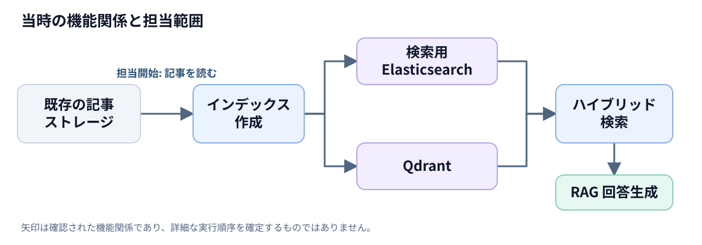
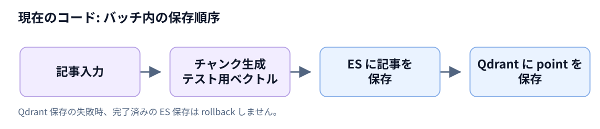

# アーキテクチャ: 当時のプロジェクトと現在のコード

[日本語 README](../README.ja.md) · [한국어版](architecture.md)

当時確認された機能関係と、現在の再構成コードの責務を分けて説明します。図は説明用に作成したもので、当時の配置構成図や原本コードではありません。

## 当時: 記事から検索・回答まで

| 段階 | 確認された範囲 |
|---|---|
| 入力 | 既存の記事ストレージを読み込む段階から担当。それ以前のデータ取り込みは別のメンバーが担当 |
| インデックス作成 | 検索用 Elasticsearch へのリインデックスと Qdrant へのベクトル格納 |
| 検索 | BM25 と dense retrieval を結合し、最終的な統合に RRF を使用 |
| 回答 | 検索された記事をコンテキストとして回答を生成 |
<!-- CLM-005: USER,CODE,RUNTIME,RETROSPECTIVE / CONFIRMED; CLM-041: USER / CONFIRMED; CLM-014: USER,CODE,RUNTIME,RETROSPECTIVE / CONFIRMED; CLM-015: USER,RETROSPECTIVE,CODE,PROPOSAL / CONFIRMED; CLM-021: USER,RETROSPECTIVE / CONFIRMED -->

### インデックス処理の変化

| | v1 | v2 |
|---|---|---|
| 記事の処理 | 1日2回の定期バッチ | 10分ごとに確認し、新着記事のみを差分処理 |
| Qdrant | 単一の dense vector | タイトル用・本文用の2つの named vectors |

繰り返しの取得・処理の負担を減らし、新着ニュースを検索に早く反映することを目指しました。既存記事の更新・削除の同期は v2 の差分処理の対象外です。この目的を定量的な成果とは捉えていません。
<!-- CLM-001: USER,CODE,PROPOSAL / CONFIRMED; CLM-002: USER / CONFIRMED; CLM-003: USER,CODE,RUNTIME,RETROSPECTIVE / CONFIRMED; CLM-004: USER,CODE,RETROSPECTIVE / CONFIRMED; CLM-043: USER / CONFIRMED -->

当時、自然言語の日付表現を解釈して日付範囲を ES・Qdrant の検索に適用し、特定日や相対日付の質問で結果が返ることを確認しました。
<!-- CLM-064: USER,CODE,PROPOSAL,RETROSPECTIVE / CONFIRMED; CLM-065: USER,CODE,RETROSPECTIVE / CONFIRMED; CLM-066: USER,RETROSPECTIVE / CONFIRMED -->

### 読む際の注意点

- 図の矢印は確認された機能関係です。ES の全件保存後に Qdrant 処理が始まるという段階の境界は未確定です。
- RRF の正確な結合順序・重みと、当時その技術を選んだ理由は未確認です。
- Graph Search では Neo4j の検索結果を LLM の回答コンテキストに含めました。共通の出力形式がどの層にあったかは未確定です。
<!-- CLM-052: USER,CODE,PROPOSAL,RETROSPECTIVE / UNRESOLVED; CLM-017: USER,CODE,PROPOSAL / PROBABLE; CLM-018: CODE,PROPOSAL,RETROSPECTIVE / UNRESOLVED; CLM-031: USER,CODE,RETROSPECTIVE / CONFIRMED; CLM-072: USER / CONFIRMED; CLM-073: USER,CODE,PROPOSAL,RETROSPECTIVE / PROBABLE -->

## 現在: 再構成したインデックス作成コア

現在のバッチ内処理の順序です。テスト用埋め込みは意味検索モデルではありません。ストレージにはアダプターを介して接続し、外部サーバーなしで stub と Qdrant のメモリストレージを使って検証します。
<!-- REC-001, REC-007: RECONSTRUCTED -->

| 責務 | コード |
|---|---|
| 記事・チャンク・ベクトル DTO | [models.py](../src/news_rag_reconstruction/models.py) |
| チャンク生成と fixture ベクトル | [chunking.py](../src/news_rag_reconstruction/chunking.py), [embeddings.py](../src/news_rag_reconstruction/embeddings.py) |
| point の構成 | [pipeline.py](../src/news_rag_reconstruction/pipeline.py), [point_ids.py](../src/news_rag_reconstruction/point_ids.py) |
| 保存インターフェースと ES・Qdrant アダプター | [storage.py](../src/news_rag_reconstruction/storage.py), [adapters/](../src/news_rag_reconstruction/adapters/) |
| バッチ処理 | [batch.py](../src/news_rag_reconstruction/batch.py) |

### 現在の設計で確認できること

記事の変換、埋め込み、point ID の生成、保存を分けることで、外部サービスの代わりとなるテスト実装を使えます。Elasticsearch には記事単位の文書を、Qdrant にはチャンク単位のベクトルを保存します。2種類の検索ストレージを併用する一般的な目的は、キーワード検索と意味検索をそれぞれ活用することです。これは現在の技術的な説明であり、当時その構成を選んだ具体的な理由を確定するものではありません。
<!-- REC-001, REC-003, REC-007: RECONSTRUCTED -->

### 失敗時の境界

変換中にエラーが発生すると、そのバッチの保存は開始しません。ES 保存中のエラーでは Qdrant 保存に進みません。ES 保存が完了した後に Qdrant 保存が失敗した場合、ES 保存を rollback せず、例外を呼び出し元に伝えます。retry・rollback・checkpoint はまだ実装されていません。

ES の bulk リクエストでは項目ごとに成功と失敗が混在するため、ES の処理で例外が発生しても**一部の文書は保存済みの可能性があります。** Qdrant のタイムアウトや通信エラーも、実際に適用されたかどうかを確定しません。前の完了済みバッチも取り消しません。

### 記事の再処理における限界

現在の UUID5 point ID は namespace・記事 ID・チャンク番号が同じであれば同一です。ただし、記事本文が短くなってチャンク数が例えば3個から1個に減ると、新しい point を upsert しても、以前の残り2個は削除されません。本文が空になった場合や元の記事が削除された場合も、既存の point は整理されません。したがって、安定した ID だけでは更新・削除の同期やデータ全体の整合性は保証できません。対応には古い point の削除と失敗時の復旧方法を別途設計する必要があります。
<!-- REC-001, REC-007: RECONSTRUCTED -->

これは当時の運用方針ではなく、**現在の再構成コードの契約**です。[関連テスト](../tests/test_batch.py#L133)
<!-- REC-007: RECONSTRUCTED -->

実際の埋め込み HTTP 呼び出し、Airflow、差分処理、検索 API、RAG 回答生成と Graph Search は現在の公開コードの範囲外です。
