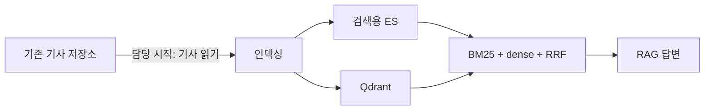
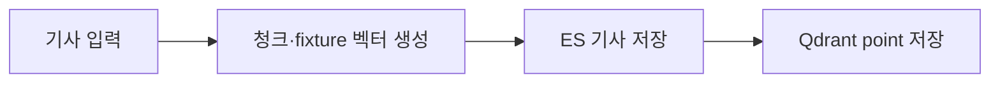

# 구조: 당시 프로젝트와 현재 코드

[한국어 README](../README.md) · [日本語版](architecture.ja.md)

이 문서는 당시 확인된 기능 관계와 현재 복원 코드의 책임을 분리합니다. 그림은 설명을 위해 작성한 것으로 당시 배포 구성도나 원본 코드가 아닙니다.

## 당시: 기사에서 검색·답변까지

| 단계 | 확인된 범위 |
|---|---|
| 입력 | 기존 기사 저장소를 읽는 지점부터 직접 구현. 이전 단계의 데이터 적재는 다른 팀원의 범위 |
| 인덱싱 | 검색용 Elasticsearch 리인덱싱과 Qdrant 벡터 적재 |
| 검색 | BM25와 dense retrieval을 결합하고 최종 fusion으로 RRF 사용 |
| 답변 | 검색된 기사 문맥으로 답변 생성 |
<!-- CLM-005: USER,CODE,RUNTIME,RETROSPECTIVE / CONFIRMED; CLM-041: USER / CONFIRMED; CLM-014: USER,CODE,RUNTIME,RETROSPECTIVE / CONFIRMED; CLM-015: USER,RETROSPECTIVE,CODE,PROPOSAL / CONFIRMED; CLM-021: USER,RETROSPECTIVE / CONFIRMED -->

### 인덱싱 변화

| | v1 | v2 |
|---|---|---|
| 기사 처리 | 정기 배치 | 주기적으로 확인해 신규 기사만 증분 처리 |
| Qdrant | 단일 dense vector | 제목·본문을 위한 두 named vectors |

반복 조회·처리의 부담을 줄이고 신규 뉴스가 검색에 더 빨리 반영되도록 개선하고자 했습니다. 기존 기사 수정·삭제의 동기화는 v2 증분 처리의 대상이 아니었습니다. 이 목적을 정량적인 성과로 해석하지 않습니다.
<!-- CLM-001: USER,CODE,PROPOSAL / CONFIRMED; CLM-002: USER / CONFIRMED; CLM-003: USER,CODE,RUNTIME,RETROSPECTIVE / CONFIRMED; CLM-004: USER,CODE,RETROSPECTIVE / CONFIRMED; CLM-043: USER / CONFIRMED -->

당시 자연어 날짜 표현을 해석해 날짜 범위를 ES·Qdrant 검색에 적용했고, 특정 날짜나 상대 날짜 질의에서 결과가 돌아오는 것을 확인했습니다.
<!-- CLM-064: USER,CODE,PROPOSAL,RETROSPECTIVE / CONFIRMED; CLM-065: USER,CODE,RETROSPECTIVE / CONFIRMED; CLM-066: USER,RETROSPECTIVE / CONFIRMED -->

### 해석할 때 주의할 점

- 그림의 선은 확인된 기능 관계입니다. 모든 ES 저장이 끝난 뒤 Qdrant 처리가 시작되는 전체 단계 경계는 확정되지 않았습니다.
- RRF의 정확한 결합 순서·가중치와 당시 기술 선택 이유는 확인되지 않았습니다.
- Graph Search에서는 Neo4j 조회 결과를 LLM 답변 문맥에 넣었습니다. Graph 결과의 공통 출력 계약이 어느 계층에 있었는지는 확인되지 않았습니다.
<!-- CLM-052: USER,CODE,PROPOSAL,RETROSPECTIVE / UNRESOLVED; CLM-017: USER,CODE,PROPOSAL / PROBABLE; CLM-018: CODE,PROPOSAL,RETROSPECTIVE / UNRESOLVED; CLM-031: USER,CODE,RETROSPECTIVE / CONFIRMED; CLM-072: USER / CONFIRMED; CLM-073: USER,CODE,PROPOSAL,RETROSPECTIVE / PROBABLE -->

## 현재: 재구현한 인덱싱 코어

현재 구현의 배치 내 순서입니다. 테스트용 임베딩은 의미 검색 모델이 아닙니다. 저장소 연결은 어댑터를 통해 이뤄지며 외부 서버 없이 stub과 Qdrant 메모리 저장소로 검증합니다.
<!-- REC-001, REC-007: RECONSTRUCTED -->

| 책임 | 코드 |
|---|---|
| 기사·청크·벡터 DTO | [models.py](../src/news_rag_reconstruction/models.py) |
| 청크 생성과 fixture 벡터 | [chunking.py](../src/news_rag_reconstruction/chunking.py), [embeddings.py](../src/news_rag_reconstruction/embeddings.py) |
| point 구성 | [pipeline.py](../src/news_rag_reconstruction/pipeline.py), [point_ids.py](../src/news_rag_reconstruction/point_ids.py) |
| 저장 인터페이스와 ES·Qdrant 어댑터 | [storage.py](../src/news_rag_reconstruction/storage.py), [adapters/](../src/news_rag_reconstruction/adapters/) |
| 배치 조정 | [batch.py](../src/news_rag_reconstruction/batch.py) |

### 실패 경계

변환 중 오류가 나면 해당 배치는 저장을 시작하지 않습니다. ES 저장 중 오류가 나면 Qdrant 저장으로 넘어가지 않습니다. ES 저장이 완료된 뒤 Qdrant 저장이 실패하면 완료된 ES 저장을 되돌리지 않고 예외를 전달합니다. retry·rollback·checkpoint는 아직 구현되지 않았습니다.

이 동작은 당시 운영 정책을 의미하지 않는 **현재 재구현 코드의 계약**입니다. [관련 테스트](../tests/test_batch.py#L133)
<!-- REC-007: RECONSTRUCTED -->

실제 embedding HTTP 호출, Airflow, 증분 처리, 검색 API, RAG 답변 생성과 Graph Search는 현재 공개 코드의 범위 밖입니다.
